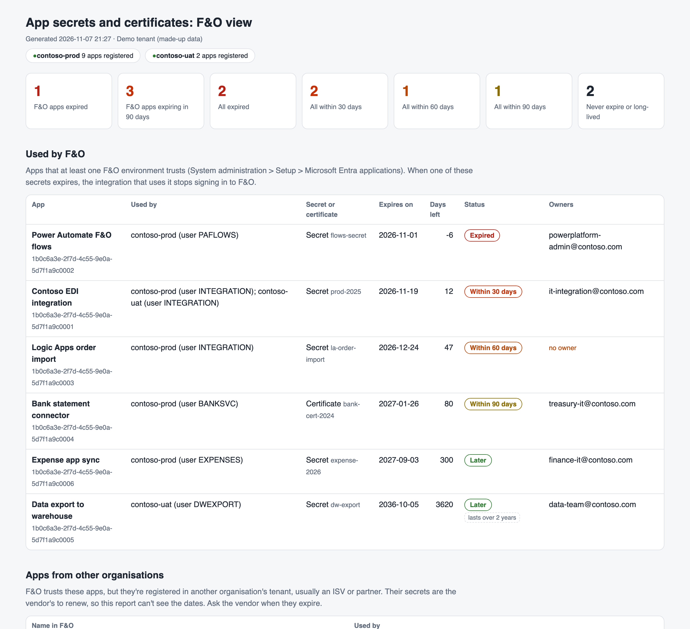
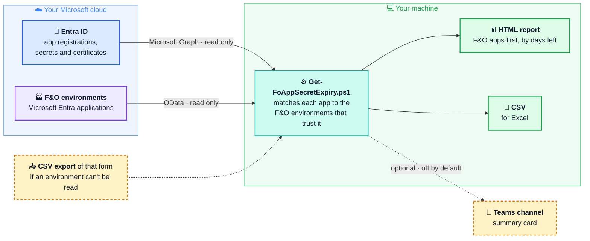

# F&O app secret expiry

[](https://github.com/DynAax-AB/dynaax-d365fo-secret-expiry/actions/workflows/test.yml)
[](https://learn.microsoft.com/powershell/scripting/install/installing-powershell)
[](#safe-to-run)
[](LICENSE)

A free, read-only PowerShell script that lists Entra app secrets and
certificates that are about to expire, and **shows which Dynamics 365 Finance
and Supply Chain Management (F&O) environments depend on each one.**



*The report, with made-up demo data.*

## What problem this solves

F&O integrations (middleware, Logic Apps, Power Automate, ISV add-ons, data
exports) sign in to F&O with Entra app registrations. When an app's secret or
certificate expires, the integration stops, often at night, and the F&O team
didn't know the date was coming.

Scripts that list expiring secrets already exist, but they list every app in
the tenant. A large tenant has hundreds. The F&O team can't tell which ones
matter to them.

This script reads the list of apps each F&O environment trusts (System
administration > Setup > Microsoft Entra applications) and matches it with the
app registrations in Entra. The F&O team gets its own list first:

- **Used by F&O**: every app an F&O environment trusts, with the environment
  and the F&O user it runs as, sorted by days left.
- **Apps from other organisations**: apps F&O trusts that are registered in an
  ISV's or partner's own tenant. The vendor manages their secrets, so ask them.
- **Apps not set up in this tenant**: apps F&O trusts that your tenant has no
  record of. Many are services Microsoft runs for F&O itself (Financial
  reporting, Copilot, Commerce and so on). The report warns not to remove them
  until you know what they are. Microsoft services the tenant does know about
  are listed apart, because Microsoft manages their secrets.
- **Other apps** that are expired or expire within 90 days.

It also flags secrets that **never expire** or are valid for **more than two
years**, which most security teams want to know about.

## How it works



The script only reads. It runs on your own machine, and the report stays there unless you
turn on the Teams post.

## Try it in one minute

No sign-in needed. With [PowerShell 7](https://learn.microsoft.com/powershell/scripting/install/installing-powershell):

```powershell
git clone https://github.com/DynAax-AB/dynaax-d365fo-secret-expiry.git
cd dynaax-d365fo-secret-expiry
./Get-FoAppSecretExpiry.ps1 -Demo
```

Open the HTML file it writes to the `output` folder.

## Run it on your tenant

### 1. Install the modules (once)

```powershell
Install-Module Microsoft.Graph.Applications -Scope CurrentUser
Install-Module Az.Accounts -Scope CurrentUser
```

Microsoft Graph reads the app registrations. Az.Accounts is only used to sign
in to F&O.

### 2. Run

```powershell
./Get-FoAppSecretExpiry.ps1 -TenantId contoso.onmicrosoft.com `
    -FoEnvironmentUrl https://contoso-prod.operations.dynamics.com,
                      https://contoso-uat.sandbox.operations.dynamics.com
```

You sign in twice in the browser: once for Microsoft Graph, once for F&O. The
script writes an HTML report and a CSV file to `./output`.

### What you need

| For | You need |
|---|---|
| Entra | A role that can read app registrations, for example Global Reader or Cloud Application Administrator, and consent to the read-only `Application.Read.All` permission. |
| F&O | Read access to each environment you list, with your normal account. |
| Your machine | PowerShell 7 on Windows, macOS or Linux. |

### If an F&O environment can't be read

The script carries on and says why in the report. For that environment, export
the list from F&O instead:

1. In F&O, open **System administration > Setup > Microsoft Entra applications**.
2. Export the grid to Excel (**Open in Microsoft Office > Export to Excel**) and
   save it as CSV, for example `contoso-prod.csv`.
3. Run the script with `-FoExportFile ./contoso-prod.csv`. The file name is
   used as the environment name.

[examples/fo-export-sample.csv](examples/fo-export-sample.csv) shows the
columns the script looks for.

## Options

| Parameter | What it does |
|---|---|
| `-FoEnvironmentUrl` | F&O environments to read, live. |
| `-FoExportFile` | CSV exports of the Microsoft Entra applications form. |
| `-TenantId` | Your tenant ID or domain. |
| `-OutputFolder` | Where to write the files. Default `./output`. |
| `-LongLivedDays` | Flag secrets valid for longer than this. Default 730 (2 years). |
| `-IncludeAll` | Show every app with a secret or certificate, not only those that need attention. |
| `-TeamsWorkflowUrl` | Post a summary to a Teams channel. Off unless you set it. See [docs/teams-and-scheduling.md](docs/teams-and-scheduling.md). |
| `-ClientId`, `-CertificateThumbprint` | Sign in as an app for unattended runs. See [docs/teams-and-scheduling.md](docs/teams-and-scheduling.md). |
| `-Demo` | Use made-up data. |

## Safe to run

- **Read only.** The script only reads from Microsoft Graph and F&O. It asks
  for `Application.Read.All` and nothing else, and only sends GET requests to
  F&O. A test checks that the code contains no other write calls.
- **One optional outgoing message.** The Teams post happens only when you pass
  `-TeamsWorkflowUrl`.
- **Personal data.** The report lists app owners (names or email addresses).
  It stays on your machine. Share it only with people who need it.
- **No secrets in the output.** The report shows secret names and dates, never
  secret values. Graph never returns secret values anyway.

## Tests

The logic is in a module (`src/FoSecretExpiry`) with
[Pester](https://pester.dev) tests that use fake Graph and F&O responses, so
they run without a tenant:

```powershell
Install-Module Pester -Scope CurrentUser -SkipPublisherCheck
Invoke-Pester ./tests
```

## Contributing

Issues and pull requests are welcome. Please run the tests first, keep the
script read-only, and don't include tenant data in issues.

## Licence

[MIT](LICENSE). Free to use, change and share. This is a community project. It
isn't affiliated with or endorsed by Microsoft.
